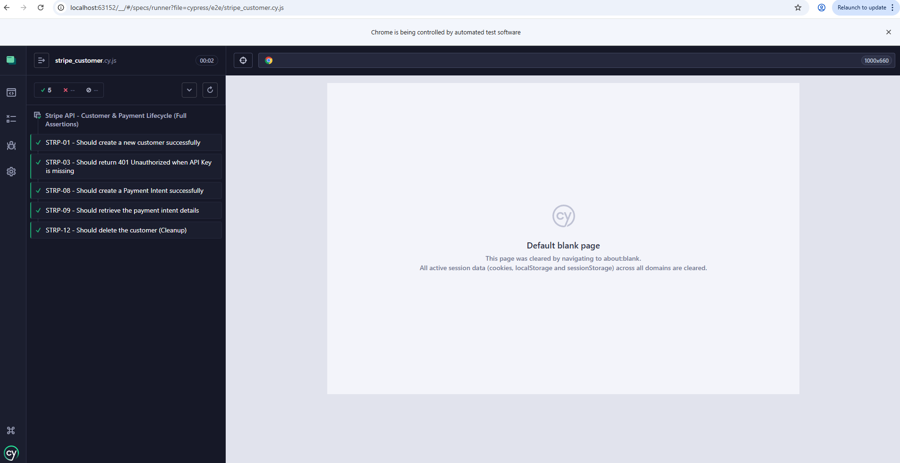

# 💳 Stripe API Automation Testing - Cypress

This project was developed as a practical hands-on portfolio project to apply API testing fundamentals, transition from manual test case execution to basic automated testing with **Cypress**, and practice API security standards.

---

## 📄 Test Documentation & Cases
* 📊 [View Full Manual API Test Suite & Execution Report (Google Docs)](https://docs.google.com/document/d/1TfghTD2BEfvoRMu8z6wvn57-aPJbuJmGsh2H6fR3Iys/edit?usp=sharing)
- 📊 [View Full API Test Suite & Matrix (Google Sheets)](https://docs.google.com/spreadsheets/d/1rXN0zlR-r_8F0hksMomoDeSEBKeDJcNWPiQ4zA73E10/edit?usp=sharing): Detailed test suite planning, status, and API coverage mapping.

---

## 🚀 Test Scenarios
* **STRP-01:** Successfully create a new customer.
* **STRP-03:** Security validation *(Expects 401 Unauthorized when the API Key is missing/invalid)*.
* **STRP-08:** Successfully create a Payment Intent.
* **STRP-09:** Retrieve specific details of an existing payment.
* **STRP-12:** Data Cleanup *(Successfully delete the customer created during the tests)*.

---

## 🛠️ Tech Stack
* **Framework:** Cypress (API Automation)
* **Language:** JavaScript (ES6+)
* **Target Service:** Stripe REST API

---

## 🔧 Setup & Installation

Follow these steps to run the project locally:

1. Clone the repository:
git clone https://github.com/seu-usuario/seu-repositorio.git
cd seu-repositorio

2. Install dependencies:
npm install

3. Configure Environment Variables:
- Create a `cypress.env.json` file in the root directory.
- Copy the structure from `cypress.env.example.json`.
- Insert your Stripe Secret Key (`sk_test_...`).

---

## 🚀 How to Run the Tests

To run the tests in headless mode via terminal:
npx cypress run --spec cypress/e2e/stripe_tests.cy.js

To open the Cypress Test Runner (Interactive UI):
npx cypress open

---
## 📸 Execution Evidence

#### 1. Full Test Suite Summary

#### 2. Detailed Results by Scenario
* **Customer & Security (STRP-01, STRP-03):** [View Screenshot](./screenshots/automation/customer-and-security.png)
* **Payment Intents (STRP-08, STRP-09):** [View Screenshot](./screenshots/automation/payment-intent-details.png)
* **Data Cleanup (STRP-12):** [View Screenshot](./screenshots/automation/data-cleanup-delete.png)

---

## 🔐 Security Note

This project follows API security standards by incorporating a `.gitignore` file to ensure sensitive credentials (such as Stripe Secret Keys) are strictly kept out of version control.
