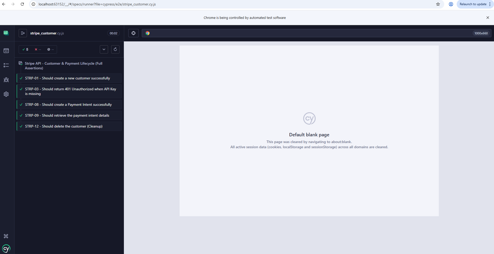

# 💳 Stripe API Testing Suite: Manual & Cypress Automation

This project features a complete API testing portfolio, combining manual test suite planning and exploratory testing in **Postman** with automated execution in **Cypress** for the Stripe REST API.

---

## 📄 Test Documentation & Cases
* 📊 [View Full Manual API Test Suite & Execution Report (Google Docs)](https://docs.google.com/document/d/1TfghTD2BEfvoRMu8z6wvn57-aPJbuJmGsh2H6fR3Iys/edit?usp=sharing)
- 📊 [View Full API Test Suite & Matrix (Google Sheets)](https://docs.google.com/spreadsheets/d/1rXN0zlR-r_8F0hksMomoDeSEBKeDJcNWPiQ4zA73E10/edit?usp=sharing): Detailed test suite planning, status, and API coverage mapping.

---

## 🎯 Key QA Highlights & Test Coverage
- **End-to-End CRUD & Data Teardown:** Full lifecycle coverage for `Customers` (`POST`, `GET`, `POST` update, `DELETE`) with automated resource cleanup after execution.
- **Payment Lifecycle & State Validation:** Testing `PaymentIntents` creation, confirmation flows, and handling response states.
- **Negative & Boundary Testing:** Validation of invalid inputs (negative amounts, malformed emails), missing required fields, and non-existent IDs (`404`).
- **Financial Business Logic:** Testing card decline scenarios (`card_declined` / `402 Payment Required`) and idempotency/double-confirmation prevention.
- **HTTP Status Code Assertions:** Strict verification of `200 OK`, `400 Bad Request`, `401 Unauthorized`, `402 Payment Required`, and `404 Not Found`.

---

## 🚀 Test Scenarios & Execution Scope
Full test suite designed and executed in **Postman**, with critical-path regression automated in **Cypress** (`cy.request()`):

| ID | Scenario | Endpoint / Method | Expected Status | Execution |
| :--- | :--- | :--- | :--- | :--- |
| **STRP-01** | Create Customer (Valid Data) | `POST /v1/customers` | `200 OK` | 🤖 Cypress & Postman |
| **STRP-02** | Create Customer (Invalid Email) | `POST /v1/customers` | `400 Bad Request` | 📋 Postman |
| **STRP-03** | Security: Missing/Invalid API Key | `POST /v1/customers` | `401 Unauthorized` | 🤖 Cypress & Postman |
| **STRP-04** | Retrieve Customer Details | `GET /v1/customers/:id` | `200 OK` | 📋 Postman |
| **STRP-05** | Update Customer Information | `POST /v1/customers/:id` | `200 OK` | 📋 Postman |
| **STRP-06** | Retrieve Non-Existent Customer | `GET /v1/customers/cus_invalid` | `404 Not Found` | 📋 Postman |
| **STRP-07** | Create Payment Intent (Valid) | `POST /v1/payment_intents` | `200 OK` | 📋 Postman |
| **STRP-08** | Create / Confirm Payment Intent | `POST /v1/payment_intents` | `200 OK` | 🤖 Cypress & Postman |
| **STRP-09** | Retrieve Payment Details / Declined Flow | `GET` / `POST` `payment_intents` | `200` / `402` | 🤖 Cypress & Postman |
| **STRP-10** | Create Payment Intent (Missing Amount) | `POST /v1/payment_intents` | `400 Bad Request` | 📋 Postman |
| **STRP-11** | Create Payment Intent (Negative Amount) | `POST /v1/payment_intents` | `400 Bad Request` | 📋 Postman |
| **STRP-12** | Data Cleanup / Delete Customer | `DELETE /v1/customers/:id` | `200 OK` | 🤖 Cypress & Postman |

---

## 🛠️ Tech Stack
* **API Testing & Exploration:** Postman
* **Automation Framework:** Cypress (`cy.request()`)
* **Language:** JavaScript (ES6+)
* **Target Service:** Stripe REST API

---

## 🔧 Setup & Installation

Follow these steps to run the project locally:

1. Clone the repository:
git clone https://github.com/your-username/your-repository-name.git
cd your-repository-name

2. Install dependencies:
npm install

3. Configure Environment Variables:
- Create a `cypress.env.json` file in the root directory.
- Copy the structure from `cypress.env.example.json`.
- Insert your Stripe Secret Key (`sk_test_...`).

---

## 🚀 How to Run the Tests

To run the tests in headless mode via terminal:
npx cypress run --spec cypress/e2e/stripe_tests.cy.js

To open the Cypress Test Runner (Interactive UI):
npx cypress open

---
## 📸 Execution Evidence

#### 1. Full Test Suite Summary

#### 2. Test Execution
https://github.com/user-attachments/assets/a9cc6c49-99e3-4462-835e-e5eab07014fe 
stripe_customer.cy.js.mp4

#### 3. Detailed Results by Scenario
* **Customer & Security (STRP-01, STRP-03):** [View Screenshot](./screenshots/automation/customer-and-security.png)
* **Payment Intents (STRP-08, STRP-09):** [View Screenshot](./screenshots/automation/payment-intent-details.png)
* **Data Cleanup (STRP-12):** [View Screenshot](./screenshots/automation/data-cleanup-delete.png)

---

## 🔐 Security Note

This project follows API security standards by incorporating a `.gitignore` file to ensure sensitive credentials (such as Stripe Secret Keys) are strictly kept out of version control.
